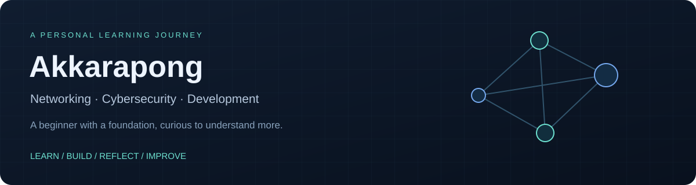

**Learning the fundamentals. Building projects. Improving step by step.**

[GitHub](https://github.com/aum-akkarapong) · [Email](mailto:aumakkara@gmail.com)

## Hi, I'm Akkarapong

I'm a beginner based in Bangkok, Thailand, with some foundational knowledge and a strong interest in **networking, cybersecurity and software development**. I learn by building tools, exploring lab environments and turning technical ideas into visual, interactive projects.

I'm still developing my understanding and practical skills. These projects reflect my learning and experimentation; they are not a claim of professional expertise, certification or production engineering experience.

## What I'm learning

| Area | Current interests |
|---|---|
| Networking | IP addressing, subnetting, switching, VLANs, routing and basic troubleshooting |
| Cybersecurity | Network traffic, defensive security concepts, monitoring and safe lab practice |
| Development | Web interfaces, scripting and connecting application behavior to underlying data |
| Tools and systems | Linux, Windows, Git and local development environments |

I explore technologies such as **TypeScript, React, Python, Node.js and Docker** through projects. A technology appearing in a repository describes what that project uses, rather than my proficiency level.

## Projects I learn through

These are personal projects and ongoing experiments. Some repositories are private, so their links may require access.

### NEXUS Network Explorer

A browser-based 3D simulation of a connected factory, combining network maps, equipment inspection, monitoring, production and electrical systems. It helps me explore how infrastructure components relate to each other and how to explain those relationships visually.

**Current scope:** four floors, 1,526 modeled devices, eight PCB lines, NEXUS Pulse, MES and a simulated desktop/terminal workspace. It does not connect to real SSH/RDP endpoints or certify a physical installation.

[View repository](https://github.com/aum-akkarapong/nexus-network-explorer)

### Network Traffic Analyzer

A personal project for exploring network traffic capture, PCAP analysis and monitoring dashboards. My focus is on understanding traffic patterns and presenting analysis results clearly.

[View repository](https://github.com/aum-akkarapong/Network-Traffic-Analyzer)

### Interactive learning projects

**Cyber Security Interactive Learning** and **Network Engineer Learning Hub** use interactive explanations and visualizations to explore security and networking concepts. The project names describe their subjects, not a professional title or qualification I hold.

[Cybersecurity project](https://github.com/aum-akkarapong/cyber-security-interactive-learning) · [Networking project](https://github.com/aum-akkarapong/network-engineer-learning-hub)

### Other experiments

- **[Sentinel PC](https://github.com/aum-akkarapong/sentinel-pc):** a local Windows monitoring project for exploring system metrics and management interfaces.
- **[Finora](https://github.com/aum-akkarapong/finora):** a local personal-finance web application for exploring web development, data storage and application structure.

## How I approach learning

- Start with the fundamentals, then test ideas in a controlled environment.
- Ask questions, check results and improve when I find mistakes.
- Clearly distinguish simulations and learning projects from real deployments.
- Explore security tools only on systems I own or have permission to test.

## Let's connect

I'm happy to exchange learning resources, receive constructive feedback and connect with others interested in networking, cybersecurity and building useful tools.

**Contact:** [aumakkara@gmail.com](mailto:aumakkara@gmail.com)
