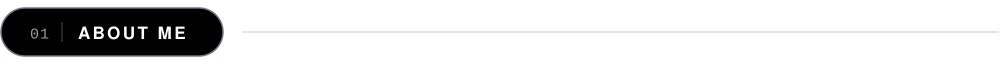
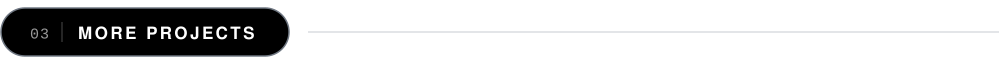
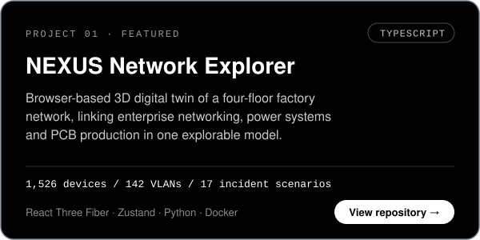
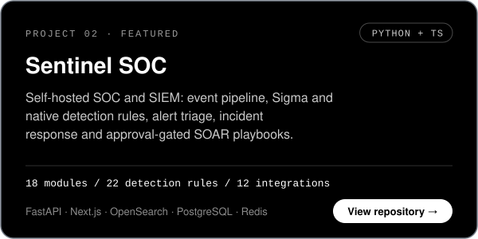
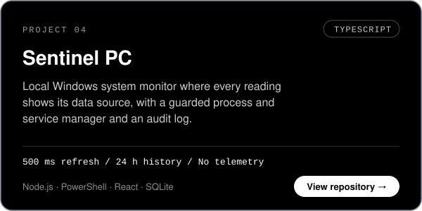
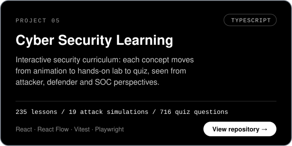
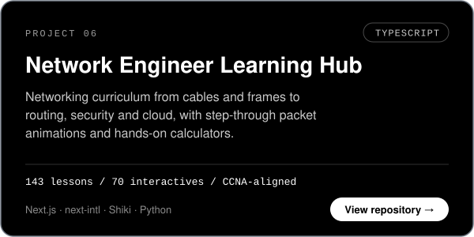
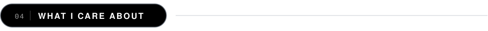
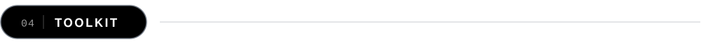
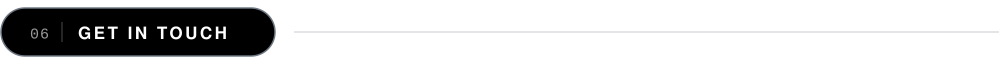

<picture>
  <source media="(prefers-color-scheme: dark)" srcset="assets/header-dark.svg">
  <source media="(prefers-color-scheme: light)" srcset="assets/header-light.svg">
  
</picture>

 

**[About](#about)** &nbsp;·&nbsp; **[Projects](#projects)** &nbsp;·&nbsp; **[Interests](#interests)** &nbsp;·&nbsp; **[Toolkit](#toolkit)** &nbsp;·&nbsp; **[Contact](#contact)**

 

I'm Akkarapong, based in Bangkok, focused on **network engineering** and **defensive security**.

I learn by building. The projects below are how I work through questions like how traffic moves through a network, how a SOC turns raw events into alerts, and how to explain a routing decision clearly. Each one is working software with its own tests and documentation, and this profile tracks that work as it grows.

| Quick facts | |
| :-- | :-- |
| **Focus** | Network engineering · defensive security · security tooling |
| **Core stack** | TypeScript · Python · React · FastAPI · Docker |
| **Lab** | Windows workstation · Kali Linux security lab · Ubuntu server |
| **Approach** | Map it → capture it → automate it |

 

Personal projects, each with its own documentation. Select a card to open the repository.

<b>Project highlights</b> — key details from each project

 

| Project | Highlights |
| :-- | :-- |
| **NEXUS Network Explorer** | Trace the network from a building view down to a single switch port, cable and VLAN · 17 incident scenarios walk through detection, impact, failover and recovery · 283 automated tests |
| **Sentinel SOC** | Event pipeline (parse → normalise → enrich → detect → alert) on Redis Streams · Sigma rules mapped to MITRE ATT&CK · disruptive SOAR actions require a second approver · tamper-evident audit log |
| **Network Traffic Analyzer** | One ingestion pipeline for live capture and PCAP files · DNS, HTTP and TLS metadata parsed from cleartext only · HTTPS is never decrypted |
| **Sentinel PC** | Unsupported sensors show *unavailable* instead of a guessed value · process and service actions are re-checked, confirmed and audited · runs on `127.0.0.1` only |
| **Cyber Security Learning** | 235 lessons in 19 modules · 172 animated scenes · 14 guided labs · content validated against schemas at build time |
| **Network Engineer Learning Hub** | 143 lessons in 18 tracks · tools for subnetting, VLSM, OSPF, BGP and ACLs · aligned with CCNA 200-301 topics |

 

The areas I keep returning to, and the projects where they show up:

| Area | What draws me to it | Explored in |
| :-- | :-- | :-- |
| **Network visibility** | Understanding how infrastructure is actually connected — topology, VLANs and the path down to an individual port. | NEXUS · Traffic Analyzer |
| **Traffic analysis & detection** | Reading packets and turning raw telemetry into alerts that are explainable and worth acting on. | Traffic Analyzer · Sentinel SOC |
| **SOC operations** | The analyst workflow end to end: triage, investigation, incident response and controlled automation. | Sentinel SOC · Cyber Security Learning |
| **Explaining systems visually** | Networks and attacks are sequences of events, so step-through animations explain them better than text alone. | Cyber Security Learning · Network Hub |
| **Transparent, local-first tools** | Software that runs on your own machine, sends nothing out, and is clear about where every number comes from. | Sentinel PC |

**How I build**

| Principle | In practice |
| :-- | :-- |
| **Defensive by design** | Analysis is passive, lab work stays isolated and authorised, and disruptive actions need confirmation or a second approver. |
| **Honest data** | Missing sensors read *unavailable*, demo data is labelled as demo, and live sources show as connected only after a real test. |
| **Explain, don't just display** | Show the reason behind a result — the packet path, the failed uplink, the source of a reading. |
| **Tested and reproducible** | Automated tests, schema-validated content and one-command Docker setups. |

 

| Category | Tools |
| :-- | :-- |
| **Languages** |        |
| **Frontend** |        |
| **Backend & Data** |        |
| **DevOps & QA** |        |
| **Network & Security** |     |

**Lab environment**

| System | Role | Used for |
| :-- | :-- | :-- |
| **Windows** | Workstation | Daily development · PowerShell automation · system monitoring tools |
| **Kali Linux** | Security lab | Traffic capture and analysis · reconnaissance in authorised labs only |
| **Ubuntu** | Server / CLI | Linux administration · Bash scripting · Docker hosts and services |

 

I'm open to collaborating on network and security projects, lab write-ups and tooling. For questions about any of the projects above, email is the best way to reach me.

 

Bangkok, Thailand · UTC+7

