

<a href="#whoami"><code>whoami</code></a> ·
<a href="#domains"><code>domains</code></a> ·
<a href="#stack"><code>stack</code></a> ·
<a href="#lab"><code>lab</code></a> ·
<a href="#projects"><code>projects</code></a> ·
<a href="#connect"><code>connect</code></a>




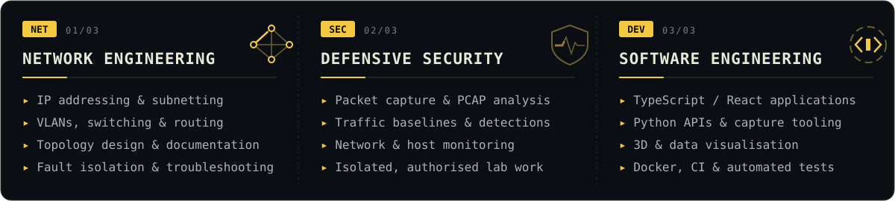






<a href="https://github.com/aum-akkarapong/nexus-network-explorer"></a>

<a href="https://github.com/aum-akkarapong/Network-Traffic-Analyzer"></a>
<a href="https://github.com/aum-akkarapong/sentinel-pc"></a>

<a href="https://github.com/aum-akkarapong/cyber-security-interactive-learning"></a>
<a href="https://github.com/aum-akkarapong/network-engineer-learning-hub"></a>

<a href="https://github.com/aum-akkarapong/sentinel-soc"></a>

<code>repositories are private · access on request</code>

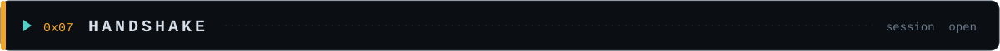


<code>// session closed · thanks for scanning</code>

