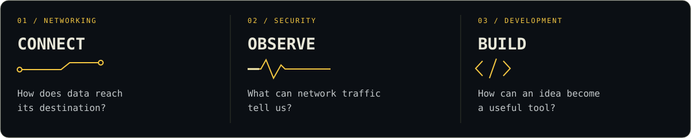
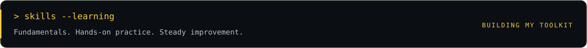

**Learning the fundamentals. Following the packets. Building along the way.**

[About](#01--about) · [Learning focus](#02--connect-observe-build) · [Projects](#03--the-project-lab) · [Skills](#04--skills-in-progress) · [Contact](#05--keep-learning-together)

## `01` / About

I'm **Akkarapong**, a beginner from Bangkok with some foundational knowledge and a growing interest in **networking, cybersecurity and development**. I learn by tracing how systems connect, testing ideas in labs and turning those ideas into visual projects.

This profile is a record of that progress: questions I'm exploring, tools I'm experimenting with and projects I'm improving step by step.

## `02` / Connect. Observe. Build.

Three questions guide my learning: **How does data reach its destination? What can traffic tell us? How can I turn an idea into a useful tool?**

| Learning focus | What I'm exploring |
|:---|:---|
| **Networking fundamentals** | IP addressing, subnetting, switching, VLANs, routing and basic troubleshooting |
| **Defensive security** | Packet capture, traffic patterns, monitoring and investigating results in a controlled lab |
| **Building tools** | Web interfaces, scripts and visual explanations that make technical concepts easier to understand |

## `03` / The project lab

### NEXUS Network Explorer

**Explore a connected factory, from the floor plan to the switch port.**

A browser-based 3D simulation brings together four floors, 1,526 modeled devices and eight PCB production lines. NEXUS Pulse provides monitoring views; MES connects production to its supporting systems; the desktop and terminal let you explore modeled device behavior.

**What I'm learning:** how addressing, cabling, power and services depend on one another, and how to make those relationships visible. Device sessions and infrastructure behavior are simulated.

[Explore NEXUS →](https://github.com/aum-akkarapong/nexus-network-explorer)

---

### Network Traffic Analyzer

**Look at the traffic behind a connection.**

A personal project exploring packet capture, PCAP analysis and monitoring dashboards. It gives me a place to investigate traffic patterns and practice explaining what the results mean.

**What I'm learning:** how network observations become useful information, and why an alert needs context before drawing conclusions.

[Explore the analyzer →](https://github.com/aum-akkarapong/Network-Traffic-Analyzer)

---

### Interactive learning projects

**Make a technical concept easier to follow.**

Cyber Security Interactive Learning and Network Engineer Learning Hub use visual explanations and interactive tools to explore networking and security topics.

**What I'm learning:** how to break a complicated process into smaller steps, test my understanding and explain it more clearly.

[Cybersecurity learning →](https://github.com/aum-akkarapong/cyber-security-interactive-learning) · [Networking learning →](https://github.com/aum-akkarapong/network-engineer-learning-hub)

**Also in the lab:** [Sentinel PC](https://github.com/aum-akkarapong/sentinel-pc), a local Windows monitoring project, and [Finora](https://github.com/aum-akkarapong/finora), a personal-finance web app for exploring interfaces and data storage.

*These are personal learning projects. Some repositories are private and require access.*

## `04` / Skills in progress

I have a foundation to build on, and I'm developing these skills through personal projects and lab practice. Tools listed here are part of that learning process.

| Area | Concepts and tools | What I'm practicing |
|:---|:---|:---|
| **Networking** | IP addressing, subnetting, VLANs, routing and switching | Following connections and working through basic connectivity problems |
| **Security & traffic analysis** | Packet capture, PCAP files and defensive monitoring concepts | Reading traffic patterns, reviewing results and understanding alert context |
| **Web development** | HTML, CSS, TypeScript, React and Node.js | Building interfaces, working with application data and understanding how the pieces connect |
| **Scripting & systems** | Python, Linux and Windows | Reading and adapting scripts, using the command line and exploring system information |
| **Project workflow** | Git, GitHub and Docker | Tracking changes, maintaining documentation and running local development environments |

**My next focus:** strengthen troubleshooting habits, understand more of the code behind my projects and explain what I learn with clear examples.

## `05` / Keep learning together

I value clear explanations, constructive feedback and the habit of checking results. I practice in my own systems and authorized labs, document what I learn and revisit mistakes as my understanding improves.

Happy to exchange resources or talk about networking, security and building useful tools.

**[aumakkara@gmail.com](mailto:aumakkara@gmail.com)** · Bangkok, Thailand

---

`learn → experiment → understand → improve`
