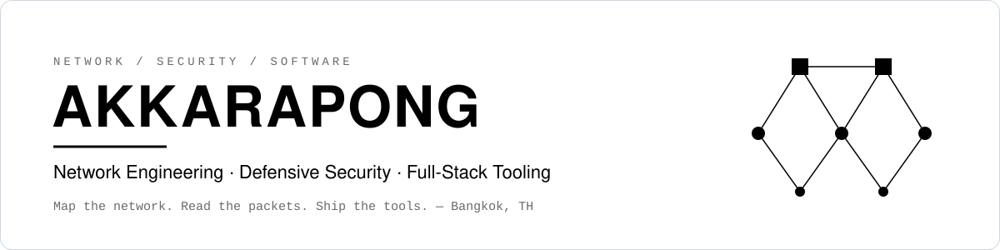

<picture>
  <source media="(prefers-color-scheme: dark)" srcset="assets/header-dark.svg">
  <source media="(prefers-color-scheme: light)" srcset="assets/header-light.svg">
  
</picture>

 

**[About](#about)** &nbsp;·&nbsp; **[Expertise](#expertise)** &nbsp;·&nbsp; **[Projects](#projects)** &nbsp;·&nbsp; **[Stack](#tech-stack)** &nbsp;·&nbsp; **[Lab](#lab-environment)** &nbsp;·&nbsp; **[Contact](#contact)**

 

## About

I'm a network and security engineer who builds software that makes networks easier to understand and defend. My work moves through three layers: **designing** networks, **watching** the traffic that crosses them, and **shipping** tools that make both understandable.

Everything I build follows the same loop: **map it → capture it → automate it.**

<table>
<tr>
<td width="25%" align="center"><h3>6</h3>Featured projects</td>
<td width="25%" align="center"><h3>378</h3>Interactive lessons authored</td>
<td width="25%" align="center"><h3>1,526</h3>Devices in a 3D network twin</td>
<td width="25%" align="center"><h3>22</h3>SOC detections shipped</td>
</tr>
</table>

 

## Expertise

<table>
<tr>
<th width="33%" align="left">01 — Network Engineering</th>
<th width="33%" align="left">02 — Defensive Security</th>
<th width="33%" align="left">03 — Software Engineering</th>
</tr>
<tr>
<td valign="top">

- IP addressing & subnetting
- VLANs, switching & routing
- Topology design & documentation
- Fault isolation & troubleshooting

</td>
<td valign="top">

- Packet capture & PCAP analysis
- Traffic baselines & detections
- Network & host monitoring
- Isolated, authorised lab work

</td>
<td valign="top">

- TypeScript / React applications
- Python APIs & capture tooling
- 3D & data visualisation
- Docker, CI & automated tests

</td>
</tr>
</table>

 

## Projects

### NEXUS Network Explorer &nbsp;<code>FEATURED</code>

> *Explore the factory. Understand the network. See the impact.*

A browser-based digital twin that connects a four-floor factory, enterprise networking, power systems and PCB production in one interactive 3D model.

| Facility | Network | Operations | Validation |
| :-: | :-: | :-: | :-: |
| **4** floors · **8** PCB lines | **1,526** devices · **2,828** links | **142** VLANs · **749** monitored hosts | **283** automated tests |

- Follow the network from the building view down to an individual switch port, cable and VLAN
- **Pulse** dashboard unifies network health, production, servers, power and alerts
- **17** incident scenarios walk through detection, impact, failover and recovery

   

---

### Sentinel SOC &nbsp;<code>FEATURED</code>

> *Telemetry, detection, triage, incident response and threat intelligence in one command center.*

A self-hosted Security Operations Center and SIEM that runs with a single `docker compose up`.

| Modules | Detections | Integrations | Roles |
| :-: | :-: | :-: | :-: |
| **18** | **22** | **12** | **6** built-in · MFA |

- Redis Streams pipeline: parse → normalise → enrich → index → detect → alert, with dead-letter queue and replay
- Native JSON and **Sigma** rules mapped to **MITRE ATT&CK**; threat hunting, threat map and IOC matching
- **Approval-gated SOAR**: disruptive actions need a second person; hash-chained, tamper-evident audit log

     

---

<table>
<tr>
<td width="50%" valign="top">

### Network Traffic Analyzer

Defensive monitoring platform: live capture or PCAP upload, **L2 → L7** decoding, streaming rule-based detections and a SOC-style dashboard.

- DNS, HTTP and TLS (SNI, ALPN, cipher) parsed from cleartext only
- HTTPS is never decrypted; passive analysis only

`FastAPI` `Scapy` `PostgreSQL` `React`

</td>
<td width="50%" valign="top">

### Sentinel PC

A local, real-time Windows system monitor that never guesses: every reading carries its source and status.

- **500 ms** cadence · **12** metric cards · **24 h** history
- Guarded process & service manager with audit log
- `127.0.0.1` only · **0** telemetry

`Node.js` `PowerShell` `React` `SQLite`

</td>
</tr>
<tr>
<td width="50%" valign="top">

### Cyber Security Interactive Learning

Learn how systems are attacked, detected and defended by watching it happen: concept → animation → lab → quiz.

- **235** lessons · **19** modules · **172** animated scenes
- **19** attack simulations · **14** labs · **716** quiz questions

`React` `React Flow` `Vitest` `Playwright`

</td>
<td width="50%" valign="top">

### Network Engineer Learning Hub

*Read it. See it. Watch it happen.* A network curriculum from cables and frames to routing, security, cloud and design.

- **143** lessons · **18** tracks · **70** interactives
- **270** glossary terms · CCNA 200-301 aligned

`Next.js` `next-intl` `Shiki` `Python`

</td>
</tr>
</table>

Repositories are private — access available on request.

 

## Engineering Principles

| Principle | In practice |
| :-- | :-- |
| **Defensive by design** | Tools analyse passively, run in isolated labs, and gate disruptive actions behind confirmation or a second approver. |
| **Honest data** | A missing sensor reads *unavailable*, demo data is labelled *DEMO*, and live sources show as connected only after a real test. |
| **Explain, don't just display** | Every system I build tries to show *why* — the packet path, the failed uplink, the source of each number. |
| **Tested and reproducible** | Automated tests, schema-validated content and one-command Docker setups. |

 

## Tech Stack

**Languages** 
      

**Frontend** 
      

**Backend & Data** 
      

**DevOps & QA** 
      

 

## Lab Environment

| System | Role | Used for |
| :-- | :-- | :-- |
| **Windows** | Workstation | Daily driver and dev box · PowerShell automation · system monitoring tooling |
| **Kali Linux** | Security lab | Traffic capture and analysis · recon in authorised labs · offensive tooling, defensive use |
| **Ubuntu** | Server / CLI | Linux administration · Bash scripting · Docker hosts and services |

   

 

## Contact

Open to network and security collaboration, lab write-ups and tooling. The fastest way to reach me is email.

 

Bangkok, Thailand · UTC+7

